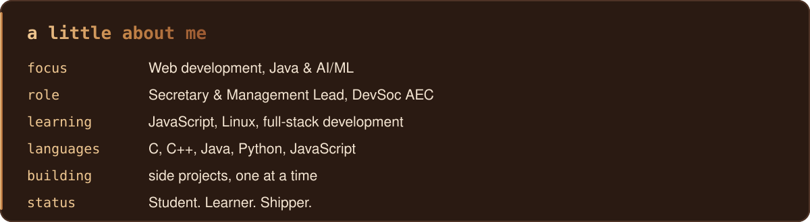

<!-- PROJECTS_ACTIVITY:START -->

<!-- REPOS:START -->

<a href="https://github.com/amrit978/Wishfor">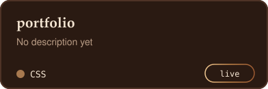</a>
<a href="https://github.com/amrit978/portfolio">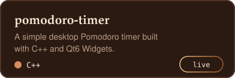</a>

<a href="https://github.com/amrit978/Expense-Tracker">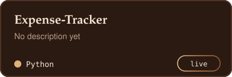</a>
<a href="https://github.com/amrit978/Tip-Calculator">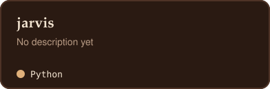</a>
<a href="https://github.com/amrit978/jarvis">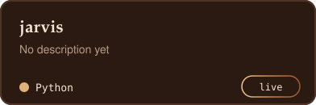</a>

<!-- REPOS:END -->

<!-- COMMITS:START -->

<a href="https://github.com/amrit978/Wishfor/commit/92aa8932c62bd07749287c7219eb73a2058a5edf">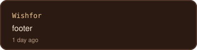</a>
<a href="https://github.com/amrit978/amrit978/commit/47cbeb29fd29752cc89178a02300bef563d9c6c9">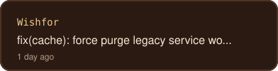</a>
<a href="https://github.com/amrit978/Wishfor/commit/f9dc68a77e4dc8a7948b203435692a35f66ce0bf">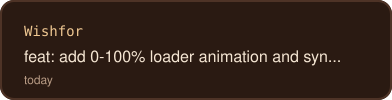</a>
<a href="https://github.com/amrit978/Wishfor/commit/bf84dbbf2d9065124557e49ce820c8a388caf6d9">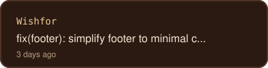</a>

<a href="https://github.com/amrit978/Wishfor/commit/272de82fa1349f10b46a6ee405ad28fcee81a483">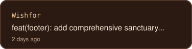</a>

<!-- COMMITS:END -->

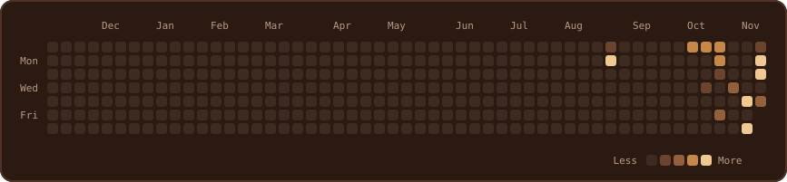

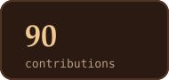
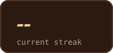
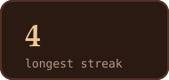
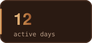

<!-- PROJECTS_ACTIVITY:END -->

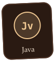
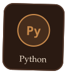
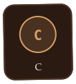
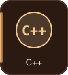
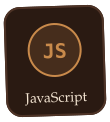

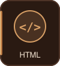
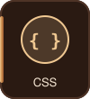
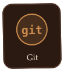
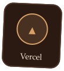
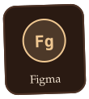

